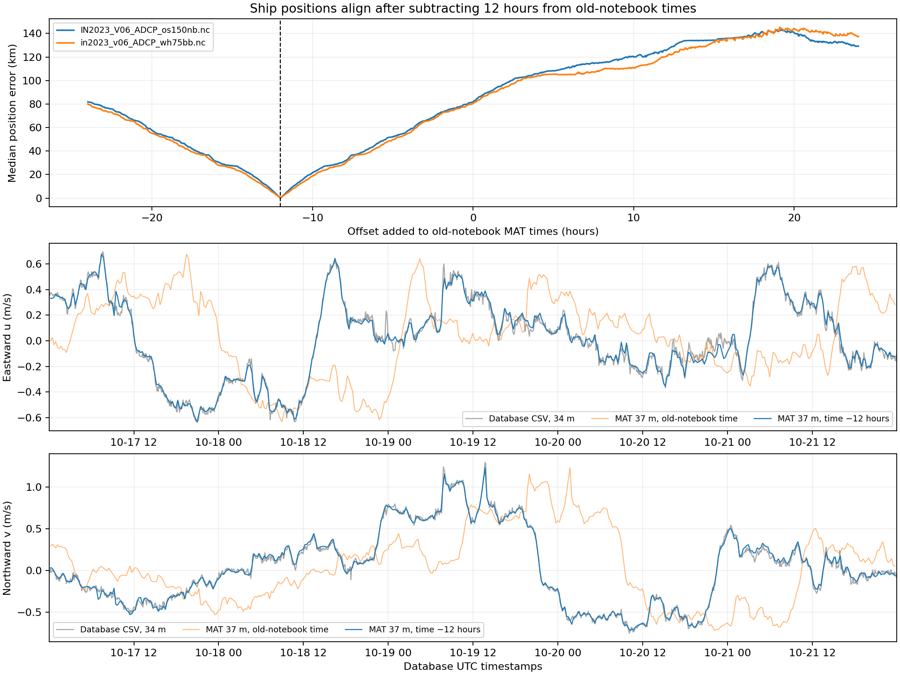

# CE23 ADCP timestamp comparison

Compared the CSIRO Data Trawler CSV with the ship-provided MAT data used by
[SOLO_transect_data.ipynb](https://github.com/regdowse/elliptical_streamfunction_parametrisation/blob/main/SOLO_transect_data.ipynb).
The local copy is `/home/z5297792/ESP_zonodo/SOLO_transect_data.ipynb`.

## Finding

**Subtract 12 hours from the times produced by the old notebook to align the
MAT observations with the database UTC timestamps.** The agreement is supported
independently by ship positions and shallow velocity components. No input data,
notebooks or time-window configs were changed by this check.

MAT arrays are identical (including NaNs) in:

- `/home/z5297792/ESP_zonodo/data/sadcp_data.mat`
- `/srv/scratch/z5297792/ESP_Paper_Data/sadcp_data_CCE_2023.mat`
- `/srv/scratch/z5297792/IN2023/sadcp.mat`

CSV: `/srv/scratch/z5297792/tilt_observation_data/MNF_IN2023_V06_adcp_trawler/MNF_IN2023_V06_adcp_trawler.csv`.

## Method and evidence

Reproduced the notebook's MAT time conversion: `2000-01-01 12:00` plus
`tim_sadcp - 2451545` days. Scanned offsets from −24 to +24 hours in one-minute
steps, interpolating each instrument's CSV ship positions to shifted MAT times.
Both instruments minimise median position mismatch at **−12 hours**:

| CSV instrument | No shift | MAT time −12 h | Matched MAT samples at −12 h |
| --- | ---: | ---: | ---: |
| OS150 | 81.739 km | 0.0074 km | 479 |
| WH75 | 80.276 km | 0.0096 km | 315 |

An additional refinement near −12 hours gives −43199.25 seconds for OS150;
the subsecond difference is negligible relative to sampling/averaging.

Compared MAT velocities at the old notebook's selected **37 m** bin with the
nearest measured shallow CSV bins, using linear interpolation in time only:

| CSV bin | Time offset | u correlation | v correlation | Vector RMSE (m/s) |
| --- | --- | ---: | ---: | ---: |
| OS150, 34 m | 0 h | 0.0095 | 0.2217 | 0.7025 |
| OS150, 34 m | −12 h | 0.9941 | 0.9978 | 0.0446 |
| WH75, 38.3 m | 0 h | 0.1300 | 0.1894 | 0.7132 |
| WH75, 38.3 m | −12 h | 0.9977 | 0.9986 | 0.0337 |

These comparisons use each instrument's available overlap (479 OS150 and 315
WH75 samples). Depths, averaging intervals and processing differ; exact velocity
identity is not expected. The CSV contains two instruments; the old plot uses one
37 m MAT level, whereas a shallowest-bin new plot may use 18 m.

The old notebook also applies `Lat <= -37` before selecting its transect.
The time-conversion code is the likely source of the 12-hour discrepancy: a
midnight reference in place of its noon reference produces the alignment found
empirically. This establishes relative alignment, not the original MAT producer's
intended Julian-date convention; the database timestamps are labelled UTC.

## Consequence for the original transect

The old notebook's selected interval **17 October 2023 13:30 → 18 October 2023
13:30** corresponds to **17 October 2023 01:30 → 18 October 2023 01:30 UTC** in
the CSV. Its 96 selected MAT observations actually span 17 October 01:42:30.667
to 18 October 01:27:30.333 UTC after correction.

Reproducing it in the new workflow requires that corrected transect interval.
Its start precedes the originally configured CE23 study-window start of
17 October 10:27:31 UTC; the SOLO enclosing study window would therefore need
adjusting too. This does not automatically imply a change to the desired LATTE
selection. The CSV itself starts on 17 October and contains the corrected
transect interval.

The current `transects.json` was separately found to contain C1 = 17 October
07:30 → 18 October 19:30 UTC, rather than the original 24-hour interval. It has
been left unchanged. No automatic timestamp correction was applied.

Detailed velocity metrics: `CE23_time_alignment_metrics.csv`.
